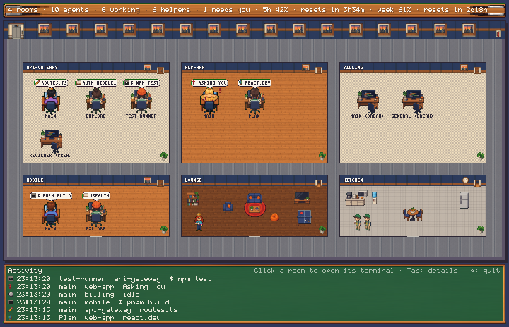

# Agent Room

Every Claude Code session you have open becomes a room in a cozy 8-bit pixel office, running full screen in a Ghostty tab. Each session's main agent is the room's boss, and every subagent it starts is an intern at the next desk. Speech bubbles show what each one is doing right now. Agents that have waited a while get up and take a break in the kitchen or the lounge.



*Four sessions:*
- *api-gateway: the boss edits `routes.ts`, two interns read code and run the tests, and the reviewer is on a break.*
- *web-app: the boss is waiting on you, with a blinking red **!**, while its intern reads docs.*
- *billing: the boss and the intern are both out: one in the lounge, one in the kitchen.*
- *mobile: the boss is building while an intern searches the code.*

## What you see

- **One room per open session**, named after the session. That's the name `/rename` sets, or the one Claude Code gives it.
- **Bosses and interns.** The session's main agent wears a crown and its own shirt colour. Subagents are interns in a striped polo, seated beside the agent that started them. Up to 10 rooms fit on one screen.
- **Live speech bubbles** show what each agent is doing: 📖 the file it's reading, ✏️ the file it's editing, `$` the command it's running, 🌐 the site it's on, or ❓ when it's asking you something.
- **Needs you.** A blinking red **!** appears over any agent waiting on a permission prompt or a question.
- **Breaks.** An agent that has waited 5 minutes leaves its desk, with its chair pushed back, and walks down the corridor to the kitchen or the lounge. Click its room and it walks back to its desk. Once everyone is seated, you're taken to that session's terminal tab.
- **Status sign.** The wooden sign above the office counts rooms, agents, working, helpers and needs-you, and shows your 5-hour and weekly usage with reset times.
- **Activity chalkboard.** A running log of what every agent did and when.
- **The rest of the office:** a lobby with reception, vending machine and printer; an elevator; skyline windows; a lounge with sofa, TV and ping-pong; a kitchen with coffee, water cooler and fridge.

## Controls

| Input | Does |
| --- | --- |
| Click a room | Calls its agents back from break, then opens that session's Ghostty tab |
| Tab, or the arrow keys | Picks a desk and shows its details on a clipboard |
| Enter | Opens the picked desk's session |
| Esc | Closes the clipboard |
| q, or ctrl+c | Quits |

## Install

```bash
git clone <this repo> ~/repos/agent-room
cd ~/repos/agent-room
./install.sh             # links the mod into ~/.claude/skills and claude-room into ~/.local/bin
./install.sh --uninstall # removes only the links into this repo
```

Then start, or restart, your Claude sessions: a session only shows up once it is started with the mod installed. In your Ghostty window, open a tab (`cmd+T`) or a split and run:

```bash
claude-room
```

## Requirements

- Ghostty 1.3 or later on macOS. It provides kitty graphics for the pixel art, and the AppleScript that switches to a session's tab.
- Node 24.2 or later.
- Claude Code with mod (function hooks) support.

## How it works

- **`mod/`** runs inside every Claude session. It writes that session's agents, their current actions, whether one needs you, your usage and recent activity to `~/.claude/agent-room/<session>.json`. It is display only: it never blocks or changes anything the session does.
- **`viewer/claude-room.ts`** reads those files five times a second, lays out the office, draws it at the largest whole-number scale that fits the tab, and sends each frame to Ghostty as a PNG.
- **Opening a session's terminal.** Ghostty doesn't say which process runs in which tab. So the viewer briefly sets a one-off title on the session's own terminal, asks Ghostty which tab shows it, puts the title back and switches to that tab.
- **Art.** The art comes from the sheets in `art/`, generated from the prompts in `art/prompts.json`. The viewer keys out their green background, finds each sprite, shrinks it to its slot, and recolours each boss's shirt. Without the sheets, the office falls back to sprites drawn in code.

## Development

```bash
claude plugin test mod                                       # mod tests
node --test 'viewer/test/*.test.ts'                          # viewer tests
node viewer/snapshot.ts docs/showcase.json docs/office.png 2880 1864   # re-render the picture above
```

`docs/showcase.json` is the scene in the picture. An agent with `"since": 0` has waited long enough to be on a break.
